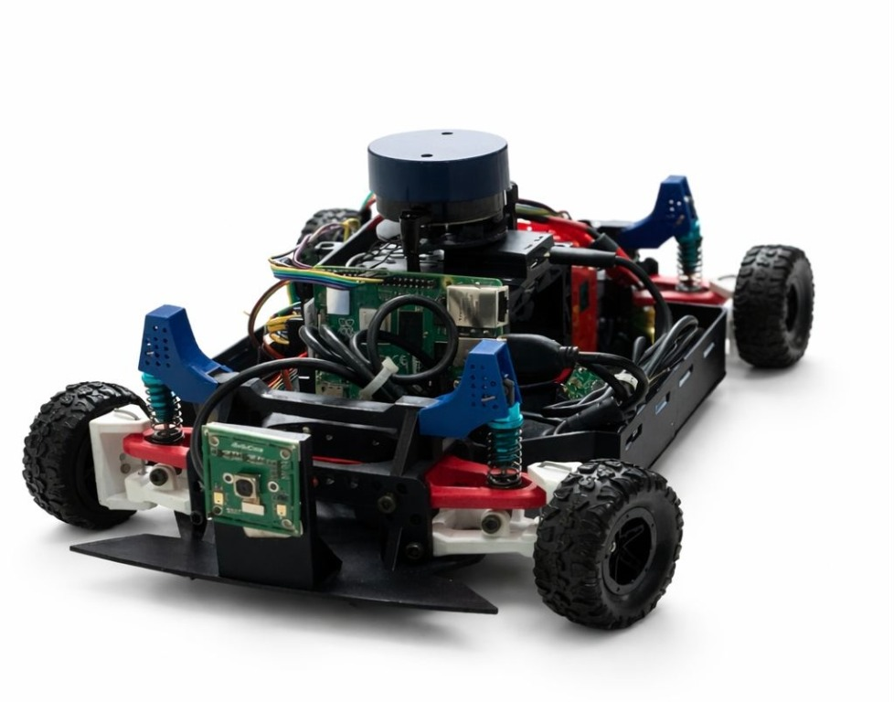
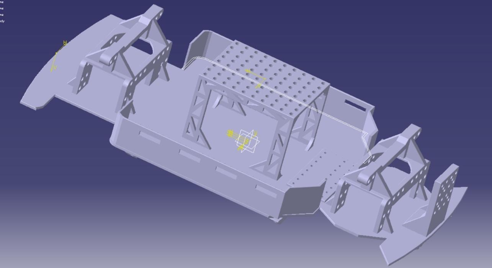

# ADAS Vehicle Simulation

A ROS 2 and Gazebo simulation of a small Ackermann-steered vehicle. The
implemented features are LiDAR obstacle detection, adaptive cruise control
(ACC), and reactive obstacle avoidance. RViz displays the simulated robot and
its LiDAR scan.

## Vehicle preview

| Prototype | CAD assembly |
|---|---|
|  |  |

More views, circuit reference, and the STEP/STL chassis files are in
[`docs/`](docs/hardware-reference.md).

This repository contains the simulation source, not a physical vehicle
controller; sensor and actuator behavior is simulated in Gazebo.

## Requirements

- Ubuntu with ROS 2 Humble
- Gazebo Fortress / Ignition Gazebo (`ign gazebo`)
- `ros_gz`, `xacro`, `robot_state_publisher`, and `rviz2`

Install any missing ROS dependencies from the package manifest:

```bash
source /opt/ros/humble/setup.bash
cd ~/adas_ws
rosdep install --from-paths src --ignore-src -r -y
```

## Build and run

```bash
cd ~/adas_ws
source /opt/ros/humble/setup.bash
colcon build --packages-select adas_vehicle
source install/setup.bash
ros2 launch adas_vehicle adas_vehicle.launch.py
```

The launch file starts Gazebo in server/headless mode to reduce graphics-memory
use, bridges simulation topics to ROS 2, spawns the vehicle and ADAS nodes, and
opens RViz. To run without RViz:

```bash
ros2 launch adas_vehicle adas_vehicle.launch.py launch_rviz:=false
```

The default test world includes LiDAR-visible obstacles and a stationary lead
vehicle. Tune node parameters in
[`src/adas_vehicle/config/adas_vehicle_params.yaml`](src/adas_vehicle/config/adas_vehicle_params.yaml).
See [the software overview](docs/software-architecture.md) for node behavior
and ROS topics, and [the hardware reference](docs/hardware-reference.md) for
component details, dimensions, and wiring.

## Package layout

- `adas_vehicle/` — obstacle detection, ACC, obstacle avoidance, and vehicle
  command nodes
- `config/` — ROS 2 node parameters
- `launch/` — Gazebo, ROS-Gazebo bridge, RViz, and node startup
- `rviz/` — robot, TF, and LiDAR visualization
- `urdf/` — Xacro description and Gazebo sensor/drive plugins
- `worlds/` — Gazebo test environment
- `docs/` — hardware reference, STEP/STL chassis models, project images, and circuit

The Xacro files are the Gazebo simulation model. The STEP is the mechanical
assembly; the STL is its tessellated mesh export. These are separate from the
Gazebo vehicle model. See the hardware notes for dimensions and limitations.

The package maintainer and contact fields still need your details before
publishing.
