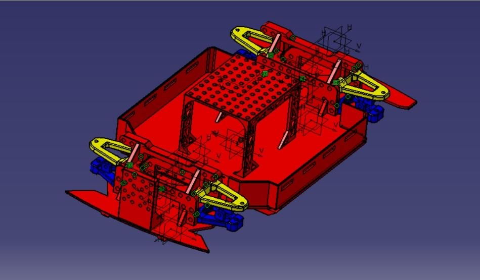
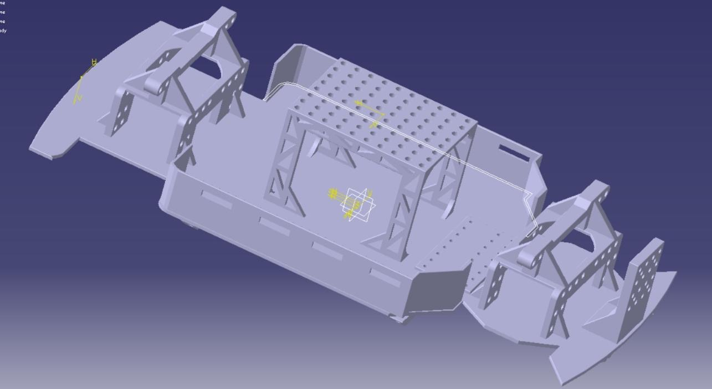
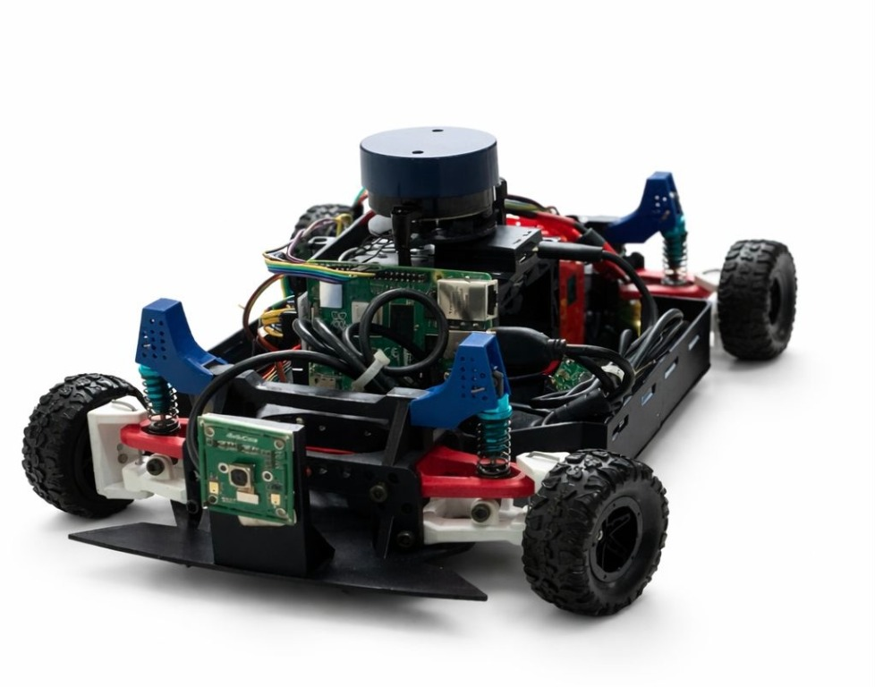
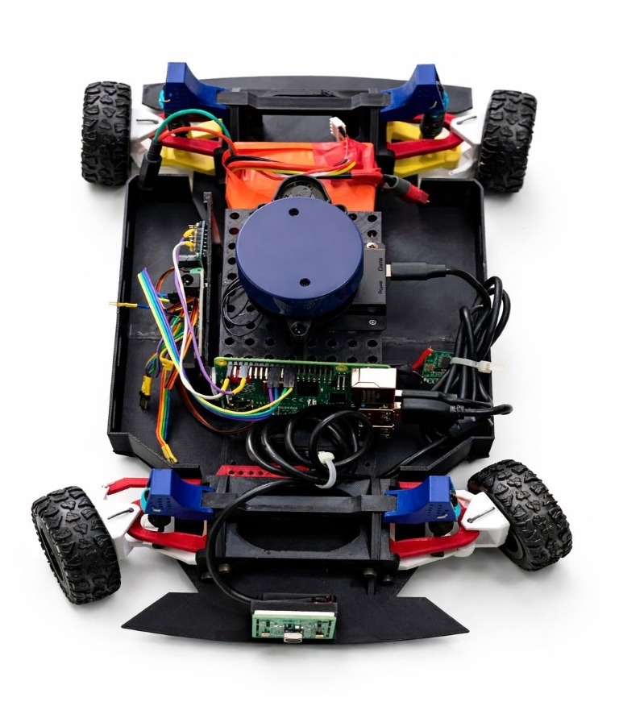
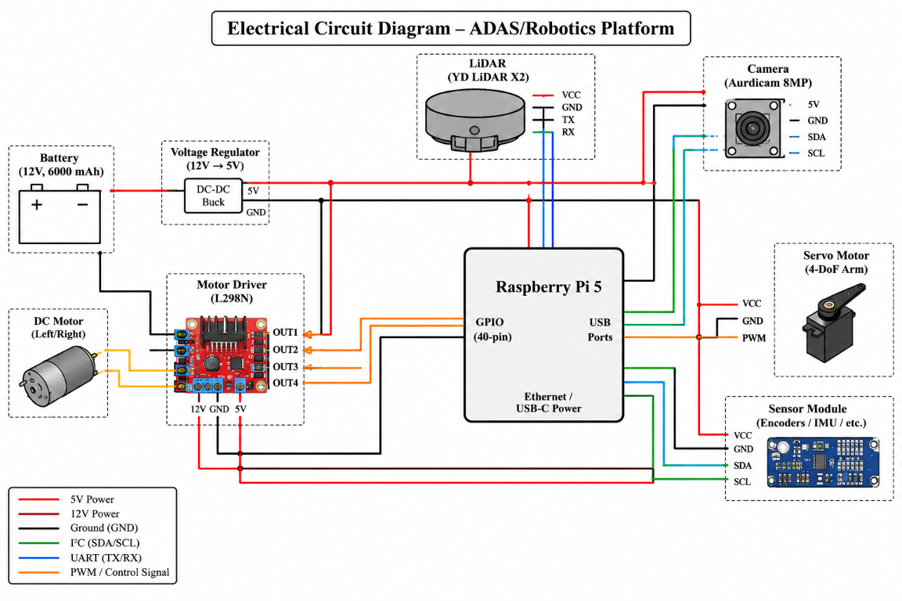

# Hardware and mechanical design reference

This page records the proposed physical research-bed hardware and the files
provided with the project. They are **not** a verified bill of materials or
wiring specification for the software simulation. The simulation uses virtual
Gazebo sensors and actuators.

## Component selection

| Component | Specification / role | Simulation status |
|---|---|---|
| Raspberry Pi 4 Model B | 4 GB RAM, quad-core Cortex-A72 at 1.5 GHz; intended ROS 2 compute unit | ROS 2 currently runs on the host; no Pi integration is in this repository |
| YDLIDAR X2 | 2D, 360-degree scan, specified range up to 8 m and UART interface | Simulated by a Gazebo GPU LiDAR: 360 samples, 15 Hz, 0.08-12 m |
| Arducam IMX219 | 8 MP Sony IMX219 sensor, CSI interface | Not included; camera-based perception is out of scope |
| MG996R servo | Steering actuator, PWM control, specified 9-11 kg-cm torque and 0-180-degree travel | Steering is simulated by Gazebo's Ackermann plugin |
| L293N motor driver | Dual H-bridge, specified 5-36 V and up to 600 mA/channel | Not electrically modeled |
| Brushed DC motors | Two drive motors; design calculations assume 30 W average and 50 W peak per motor | Drive is simulated by Gazebo's Ackermann plugin |
| Gearbox | Design calculation estimates an approximately 8:1 reduction | Not modeled separately |
| Battery | Design calculation selects 12.8 V, 6 Ah LiFePO4 | Not modeled |

### Estimated power budget

The design estimates 80.5 W average consumption and 120 W peak consumption.
For a 30-minute target runtime, it calculates 40.25 Wh before reserve and
selects a 12.8 V, 6 Ah battery with a BMS rating of at least 18 A. Estimated
average and peak currents are approximately 6.29 A and 9.38 A. These are
design assumptions, not measured simulation results.

## Chassis dimensions

The STEP assembly contains 42 valid solid parts and uses millimetres. Its base
plate measures 400 x 180 x 3 mm. The full assembly bounds are 440 x 193 x
187 mm, including the attached structures; the STL mesh has the same bounds.
The design also specifies a 380 mm wheelbase, 170 mm track width, 60 mm wheel
diameter, and 20-30 mm ground clearance, while a separate drive calculation
uses a 100 mm wheel diameter. Verify the assembled dimensions and clearances
in CAD before fabrication.

The STEP is a neutral CAD assembly suitable for import and editing in CAD
software. The STL is a tessellated mesh export of the assembly. The ROS Xacro
files in `src/adas_vehicle/urdf/` describe a different model for Gazebo: a
420 x 190 x 80 mm chassis, 330 mm wheelbase, 225 mm track, and 102 mm wheel
diameter. Do not use the simulation dimensions as fabrication dimensions.

## Chassis and prototype images

The CAD assembly renders and prototype photos below were provided with the
project. They illustrate the physical platform but do not change the simulation
scope described in the README.

CAD files:

- [STEP assembly](cad/adas-chassis-assembly.step)
- [STL mesh export](cad/adas-chassis-assembly.stl)

## Electrical circuit reference

The updated electrical diagram shows the Raspberry Pi 4-based hardware layout
and its connections to the power supply, motor driver, motors, camera, LiDAR,
servo, and sensor modules. It provides a visual reference for the proposed
platform; the simulation uses virtual Gazebo sensors and actuators.

